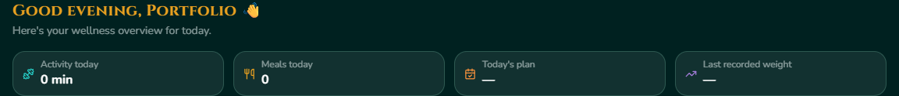

# ZenFlow Platform

ZenFlow (originally Wellness Tips) is a personal wellness journal. It combines a daily dashboard, weight and activity logs, meal tracking, notes, a planner, and a library of sample wellness articles.



## Run locally

Requirements are Node.js 24 and npm.

```sh
npm ci
npm run dev
```

Open http://localhost:3000/login. Use a sample username of at least three characters and a sample password of at least six. For a production-style local preview, run `npm run build` followed by `npm start`.

## How it works

- Next.js App Router and composable React components provide the UI. Zustand persists the demo profile and journal in this browser.
- The dashboard derives activity minutes, meals, plan status, and the last weight from recorded data.
- Sign-in, registration, coaching replies, and membership activation are local simulations. Use sample details. Activation requires no card data and processes no payment.
- The article catalog is bundled with the app. Some editorial images are loaded remotely and depend on the source remaining available.

See [Architecture](ARCHITECTURE.md). Run `npm run lint`, `npm test`, and `npm run build` to verify a change.

## Italiano

ZenFlow è il diario dimostrativo nato da Wellness Tips. Registra attività, pasti, peso e note su questo browser e usa il planner per organizzare la giornata. Per avviarlo usa `npm ci` e `npm run dev`. Accesso, coach e abbonamento sono simulati e accettano dati di esempio. Per la verifica usa i comandi indicati sopra.

## Academic context and attribution

Michele Magrone and Giovanni Rutigliano developed Wellness Tips for **Progettazione dell’Interazione con l’Utente**, Università degli Studi di Bari Aldo Moro, Department of Computer Science (ITPS), A.Y. 2024/2025. The [academic archive](docs/academic_archive) preserves the original project documentation.

The repository does not declare an open-source license. External works are subject to their respective terms.
